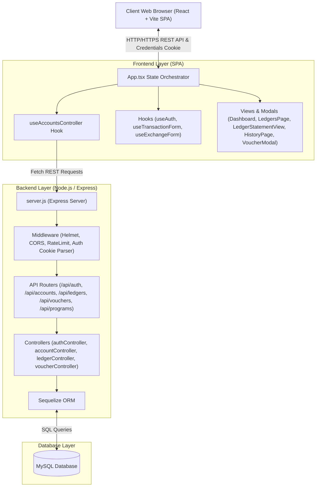
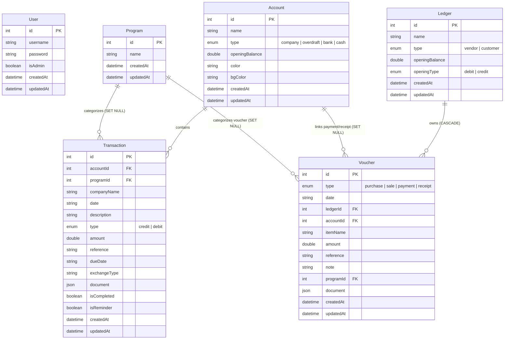
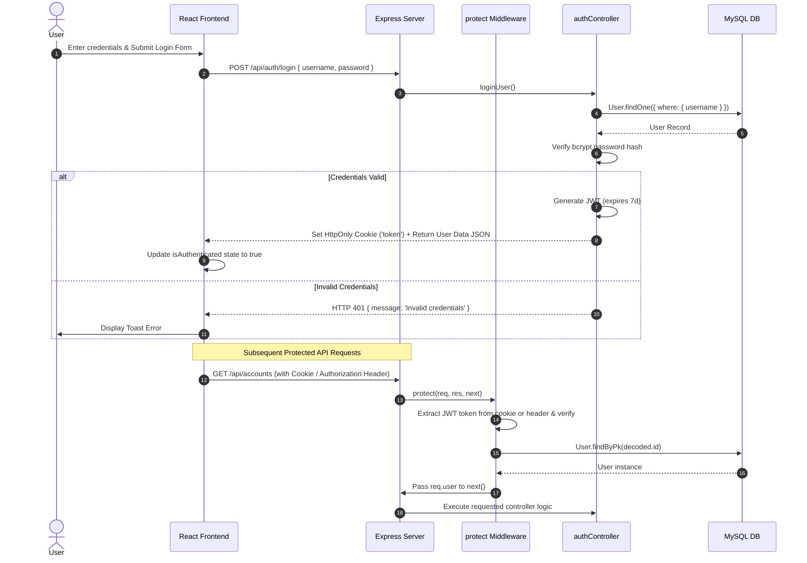
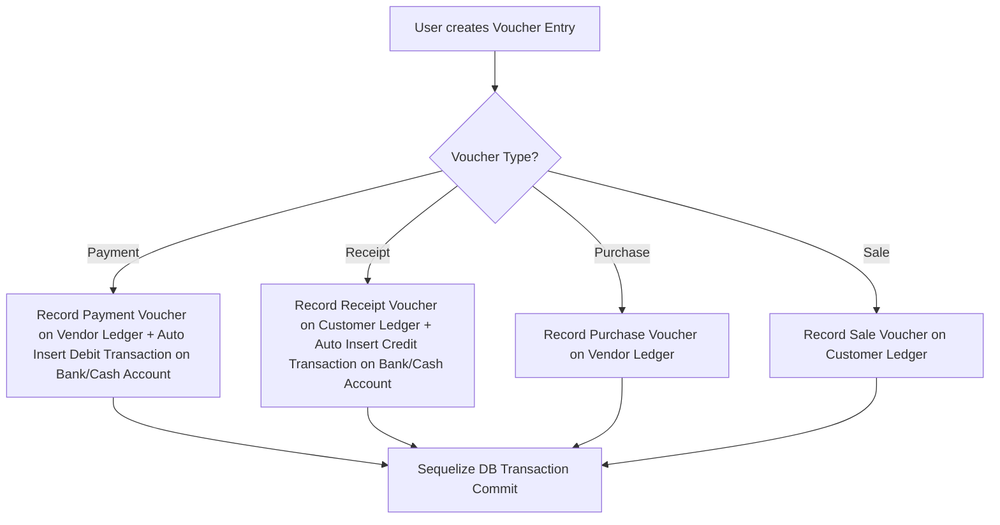
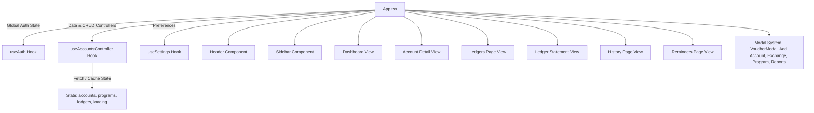

# Chisel Accounts Software — Complete Working Flow & Architecture

Comprehensive technical documentation detailing the system architecture, database schema, end-to-end data flows, API routes, frontend controller state management, and business domain workflows for Chisel Accounts Software.

---

## Table of Contents

1. [System Overview](#1-system-overview)
2. [Tech Stack & System Architecture](#2-tech-stack--system-architecture)
3. [Database Schema & Entity Relationships](#3-database-schema--entity-relationships)
4. [Authentication & Session Flow](#4-authentication--session-flow)
5. [Account Management & Financial Flow](#5-account-management--financial-flow)
6. [Transaction & Exchange / Transfer Flow](#6-transaction--exchange--transfer-flow)
7. [Double-Entry Ledger & Voucher System](#7-double-entry-ledger--voucher-system)
8. [Program Tagging & Categorization Flow](#8-program-tagging--categorization-flow)
9. [Reminders, Due Dates & History Audit Flow](#9-reminders-due-dates--history-audit-flow)
10. [Frontend Component & Hook Controller Flow](#10-frontend-component--hook-controller-flow)
11. [API Endpoint Reference](#11-api-endpoint-reference)
12. [Security, Middleware & Production Considerations](#12-security-middleware--production-considerations)

---

## 1. System Overview

Chisel Accounts Software is a full-stack financial accounting, vendor/customer double-entry ledger tracking, and cash-flow management application. It provides real-time ledger tracking across multi-type accounts (Company, Bank, Cash, Overdraft), inter-account transfers/exchanges, double-entry vendor and customer ledgers (purchases, sales, payments, and receipts), program/project cost allocation, document attachments, reminder management, and financial audit capabilities.

---

## 2. Tech Stack & System Architecture

### Stack Components
- Frontend: React 18, Vite, TypeScript, Tailwind CSS, Lucide Icons, Sonner Toast Notifications, Recharts.
- Backend: Node.js, Express.js (ES Modules), Sequelize ORM.
- Database: MySQL with auto-database creation, dynamic schema migration scripts (migrateOldVendorsToLedgers), and foreign key cascade rules.
- Authentication: JWT stored in HttpOnly, SameSite cookies with fallback bearer headers.

---

## 3. Database Schema & Entity Relationships

---

## 4. Authentication & Session Flow

---

## 5. Account Management & Financial Flow

Accounts represent financial ledgers (Company, Overdraft, Bank, Cash).

### Calculation Logic
- Current Balance Calculation:
  $$\text{Current Balance} = \text{Opening Balance} + \sum \text{Credits} - \sum \text{Debits}$$
- Account Types:
  - company: Standard operational accounts.
  - bank: Bank accounts.
  - cash: Liquid cash accounts.
  - overdraft: Overdraft credit facilities.

---

## 6. Transaction & Exchange / Transfer Flow

Transactions handle direct revenue/expenses, inter-account transfers, and auto-generated payment/receipt voucher entries.

---

## 7. Double-Entry Ledger & Voucher System

Replaces disconnected vendor tallies with a real double-entry ledger system for Vendors and Customers.

### Posting Rules

| Voucher Type | Ledger Balance Effect | Bank / Cash Account Effect |
| :--- | :--- | :--- |
| Purchase | + to Vendor Balance Owed | None |
| Payment | - from Vendor Balance Owed | - from Account, auto Transaction ("Payment to <vendor>", ref PAY-xxxxxx) |
| Sale | + to Customer Balance Owed | None |
| Receipt | - from Customer Balance Owed | + to Account, auto Transaction ("Receipt from <customer>", ref REC-xxxxxx) |

### Balance Formulas
- Vendor Ledger Balance:
  $$\text{Balance Due} = \text{Opening Balance} + \sum \text{Purchases} - \sum \text{Payments}$$
- Customer Ledger Balance:
  $$\text{Balance Due} = \text{Opening Balance} + \sum \text{Sales} - \sum \text{Receipts}$$
- Gross Profit:
  $$\text{Gross Profit} = \sum \text{Total Sales} - \sum \text{Total Purchases}$$

---

## 8. Program Tagging & Categorization Flow

Programs allow grouping transactions and vouchers under project codes or expense tags.

---

## 9. Reminders, Due Dates & History Audit Flow

Due date tracking, overdue alerts, completion status toggle, audit trail / history view with search, filter by type/date range/account.

---

## 10. Frontend Component & Hook Controller Flow

---

## 11. API Endpoint Reference

| Method | Endpoint | Protection | Description |
| :--- | :--- | :--- | :--- |
| POST | /api/auth/login | Public | Authenticate user & set JWT cookie |
| POST | /api/auth/register | Public | Register new user |
| POST | /api/auth/logout | Public | Clear auth cookie |
| GET | /api/auth/me | Protected | Fetch current user profile |
| PUT | /api/auth/credentials | Protected | Update username / password |
| GET | /api/accounts | Protected | Fetch all accounts & nested transactions |
| POST | /api/accounts | Protected | Create new account |
| PUT | /api/accounts/:id | Protected | Rename account |
| PUT | /api/accounts/:id/balance | Protected | Update account opening balance |
| DELETE | /api/accounts/:id | Protected | Delete account & cascade delete transactions |
| POST | /api/accounts/:id/transactions | Protected | Add transaction to account |
| PUT | /api/accounts/:id/transactions/:txId | Protected | Edit transaction (or toggle isCompleted) |
| DELETE | /api/accounts/:id/transactions/:txId | Protected | Delete transaction |
| GET | /api/ledgers?type=vendor|customer | Protected | Fetch all ledgers with calculated totals |
| POST | /api/ledgers | Protected | Create new vendor or customer ledger |
| DELETE | /api/ledgers/:id | Protected | Delete ledger & linked vouchers |
| GET | /api/ledgers/:id/statement | Protected | Fetch running ledger statement (Dr/Cr/Balance) |
| POST | /api/vouchers | Protected | Create voucher (Purchase, Sale, Payment, Receipt) |
| DELETE | /api/vouchers/:id | Protected | Delete voucher & linked bank transaction |
| GET | /api/vouchers/profit | Protected | Fetch gross profit report ($\sum \text{Sales} - \sum \text{Purchases}$) |
| GET | /api/programs | Protected | Fetch all programs |
| POST | /api/programs | Protected | Create new program |
| DELETE | /api/programs/:id | Protected | Delete program |

---

## 12. Security, Middleware & Production Considerations

1. Cookie Security:
   - HttpOnly: true (prevents XSS access to tokens).
   - SameSite: 'none' + Secure: true in production.
2. Reverse Proxy & Trust Proxy:
   - app.set('trust proxy', 1) enables accurate client IP tracking for rate limiting.
3. Double-Entry DB Transactions:
   - Payments and Receipts are committed inside single database transactions (sequelize.transaction) to guarantee data integrity between Vouchers and Account Transactions.
